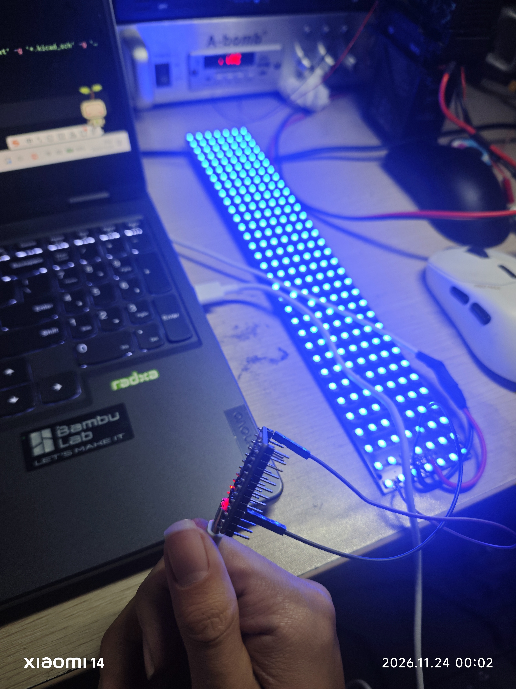

# 大符长条灯板

本项目复用上上赛季留下的大符长条灯板，使用 nRF52840 进行低亮度点灯测试。当前固件按 231 颗灯珠发送数据，上电先清灯，再点亮蓝色。

## 测试主控与固件

- **主控**为 Nordic nRF52840（Arm Cortex-M4F，64 MHz）。测试工程使用 Arduino nRF52 的 `PCA10056` 板级配置，数据从 `P0.09` 输出，由 `PWM0 + EasyDMA` 发送 24 位 GRB 单线数据，位周期为 1.25 µs。[Nordic nRF52840 规格](https://www.nordicsemi.com/products/nrf52840)
- [led231_blue.cpp](led231_blue.cpp) 是 C++ 点灯测试源码。[build.py](build.py) 使用 Arm GNU 工具链、CMSIS 和 Arduino nRF52 core 构建 `led231_blue.uf2`。该 UF2 针对使用 S140 6.1.1 的 nRF52840 UF2 引导程序。
- `P0.09` 与 NFC 复用，沿用测试接法时需要将其配置为 GPIO。Nordic 将该脚标为低频 I/O，正式版本可选用支持高速输出的普通 GPIO，并在首颗灯珠的 `DIN` 处复测波形。[Nordic 引脚规格](https://docs.nordicsemi.com/r/bundle/ps_nrf52840/page/pin.html?contentId=hMpuE~dcsjrrIlIt8ErcrQ)

## 移植到其他 Arm 主控

把 `led231_blue.cpp` 中的颜色、像素数量和 GRB 帧编码逻辑放进目标主控工程。按目标板替换 GPIO、PWM/DMA 等外设代码，保留单线脉宽和帧末低电平锁存时序，再用目标芯片的 SDK 和工具链重新编译烧录。移植时从源码构建目标固件，上述构建脚本生成的 UF2 对应上述 nRF52840 测试配置。

## 5 V 供电与接线

实测时，**灯板仍用 USB-A 飞线取 5 V**，主控板也通过 USB 接在**同一台电脑**上。两块板各自从这台电脑取电，另外用一根线把**主控 `GND` 和灯板 `GND` 直接连起来**。按此接法，灯板正常点亮蓝色。

```text
同一台电脑
├─ USB 线 ────────────→ nRF52840 主控板 USB 供电口
└─ USB-A 飞线 5 V/GND ─→ 灯板 5V/VIN 和 GND

主控 GND ── 独立地线 ── 灯板 GND
主控 P0.09 ── 数据线 ─→ 首颗灯珠 DIN
```

- USB-A 飞线只接 `5 V` 和 `GND`。上电前核对极性，台架测试先用低亮度。
- 若按图纸改用 DC-DC 供电，两块板的供电入口仍使用稳压 5 V，DC-DC 输出地与主控、灯板的 `GND` 连通。按实际灯效的电流选 DC-DC 供电余量。

## 实测照片


